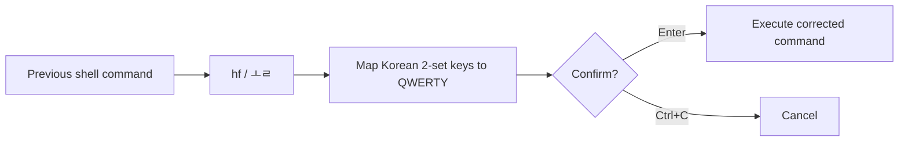

# hanfix

[](https://github.com/NaNIsaac/hanfix/actions/workflows/ci.yml) [](LICENSE)

**Typed a command with the Korean keyboard layout still on? Type `hf` and hanfix re-runs it in QWERTY.**

[한국어](README.ko.md)

## Quick install

**1. Install the latest release**

**Windows (PowerShell)**

<!-- test windows -->
```powershell
irm https://github.com/NaNIsaac/hanfix/releases/latest/download/install.ps1 | iex
```

**Linux / macOS**

<!-- test unix -->
```sh
curl -fsSL https://github.com/NaNIsaac/hanfix/releases/latest/download/install.sh | sh
```

**2. Enable `hf` in your shell**

`hf` is a shell function, because only the shell knows the previous command, so it needs one line in your shell's start-up file. Run this once.

**PowerShell**

<!-- test windows -->
```powershell
New-Item -ItemType Directory -Force (Split-Path $PROFILE) | Out-Null; Add-Content $PROFILE 'Invoke-Expression (hanfix --init powershell | Out-String)'
```

**bash**

<!-- test unix -->
```sh
echo 'eval "$(hanfix --init bash)"' >> ~/.bashrc
```

For zsh (the macOS default) and fish, see [Shell setup](#shell-setup).

**3. Open a new terminal and check that `hf` exists**

<!-- test windows -->
```powershell
Get-Command hf
```

<!-- test unix -->
```sh
bash -ic 'type hf'
```

Try the conversion on its own. It only prints:

<!-- test console -->
```console
$ hanfix ㅣㄴ -ㅁ
ls -a
$ hanfix dkssudgktpdy
안녕하세요
```

The scripts download a release binary and verify its SHA-256 checksum. You can [inspect the installers](https://github.com/NaNIsaac/hanfix/tree/main) before running remote code. For Cargo or manual downloads, see [Install](#install).

```console
$ ㅣㄴ -ㅁ
bash: ㅣㄴ: command not found
$ ㅗㄹ
ls -a  [Enter / Ctrl+C]
.  ..  .git  README.md	src
$ 햣 촏차ㅐㅕㅅ -ㅠ 럍-쇼ㅔㅐ
bash: 햣: command not found
$ ㅗㄹ
git checkout -b fix-typo  [Enter / Ctrl+C]
Switched to a new branch 'fix-typo'
```

`ㅗㄹ` is what `hf` becomes when the Korean layout is still on, so both names work and you never have to
switch layouts to fix the mistake.

On a Korean keyboard, forgetting to press the 한/영 key turns `ls -a` into `ㅣㄴ -ㅁ`. hanfix maps the
Hangul back to the keys you pressed (2-set / KS X 5002 layout), shows the fixed command, and runs it when
you press Enter. It works on Linux, macOS and Windows, with bash, zsh, fish and PowerShell.


## How the correction works

The following is an **illustrative terminal interaction**, not a screenshot or a recorded run. `hf` reads the previous command from your shell history; it does not monitor your keystrokes.

```text
  Korean keyboard layout is still active
  ┌───────────────────────────────────────┐
  │ $ ㅣㄴ -ㅁ                              │
  │ bash: ㅣㄴ: command not found           │
  └───────────────────────────────────────┘
                    │
                    ▼
  ┌───────────────────────────────────────┐
  │ $ ㅗㄹ                                  │
  │ ls -a           [Enter / Ctrl+C]      │
  └───────────────────────────────────────┘
            │                   │
         Enter                Ctrl+C
            ▼                   ▼
      Run corrected        Cancel without
      command              running it
```



**Important:** `hf -y` skips confirmation. Use the normal `hf` first when the corrected command could modify files.

## Install

**Linux / macOS**

```sh
curl -fsSL https://github.com/NaNIsaac/hanfix/releases/latest/download/install.sh | sh
```

**Windows (PowerShell)**

```powershell
irm https://github.com/NaNIsaac/hanfix/releases/latest/download/install.ps1 | iex
```

The install script:
1. Downloads the executable for your OS and CPU from [Releases](https://github.com/NaNIsaac/hanfix/releases).
2. Checks its SHA-256 checksum.
3. Puts it in the install folder.
   - Linux/macOS: `~/.local/bin`
   - Windows: `%LOCALAPPDATA%\Programs\hanfix`, which is added to your user PATH.
4. Prints the line to add to your shell configuration.

Set `HANFIX_INSTALL_DIR` to change the install folder, and `HANFIX_VERSION=v0.2.3` to pick a version.

Termux (aarch64) is tested in CI.

With Rust, you can install from source:

```sh
cargo install --git https://github.com/NaNIsaac/hanfix
```

## Update

```sh
hanfix --update
```

- Re-runs the install script to replace this copy with the latest release, in the folder the running hanfix is in.
- The checksum is checked as on a first install.
- Re-running the install command (`curl … | sh`, `irm … | iex`) does the same.
- If you installed with `cargo install`, use `cargo install --git https://github.com/NaNIsaac/hanfix --force`.
- `hanfix -V` prints the current version.

## Shell setup

`hf` is a shell function, because only the shell knows the previous command. Add one line to your shell's
start-up file and open a new terminal.

| Shell | File | Line |
|---|---|---|
| bash | `~/.bashrc` | `eval "$(hanfix --init bash)"` |
| zsh | `~/.zshrc` | `eval "$(hanfix --init zsh)"` |
| fish | `~/.config/fish/config.fish` | `hanfix --init fish \| source` |
| PowerShell | `$PROFILE` | `Invoke-Expression (hanfix --init powershell \| Out-String)` |

In PowerShell, run this once:

```powershell
New-Item -ItemType Directory -Force (Split-Path $PROFILE) | Out-Null; Add-Content $PROFILE 'Invoke-Expression (hanfix --init powershell | Out-String)'
```

To see the code that gets defined, run e.g. `hanfix --init bash`.

## Usage

### Fix the previous command

| Command | What it does |
|---|---|
| `hf` or `ㅗㄹ` | Shows the fixed command and runs it on Enter. Ctrl+C cancels. |
| `hf -y` | Runs it without asking. |

**Steps**
1. Takes the previous command from shell history, skipping `hf` itself.
2. Maps Hangul jamo back to English keys. If nothing changes, prints `nothing to fix` and stops.
3. Shows the fixed command in green and waits for Enter.
4. Adds the fixed command to shell history and runs it, so the up arrow brings it back. fish does not get
   the history entry.

With [codigest](https://github.com/NaNIsaac/codigest)'s terminal capture on (bash, zsh, PowerShell), the
fixed command still gets the terminal, so an editor or `codex` opens as usual; codigest captures it by
its own rules, as if you had typed it.

`--alias` renames the function. The Korean-layout name is defined too; for example `--alias fk` defines
`fk` and `라`.

```sh
eval "$(hanfix --init bash --alias fk)"
```

### Convert text directly

```
hanfix ㅣㄴ -ㅁ               ->  ls -a
hanfix 햣 ㄴㅅㅁ션             ->  git status
hanfix dkssudgktpdy          ->  안녕하세요
echo ㅊㅇ .. | hanfix         ->  cd ..          (reads stdin too)
hanfix --to ko git           ->  햣             (forced direction)
hanfix --to en 한글           ->  gksrmf
```

**The direction is automatic.** Text with any Hangul goes back to English keys; anything else is composed
into Hangul. If the guess is wrong, use `--to ko` or `--to en`.

### Decode escaped Korean text

File names and URLs sometimes carry Korean as escaped UTF-8 bytes: `_ED_8A_B8_EB_A6_AC` or
`%ED%8A%B8%EB%A6%AC` instead of `트리`. `hanfix inspect` explains what it finds; `hanfix decode` turns it back,
using only the type you name.

```console
$ hanfix inspect _ED_8A_B8_EB_A6_AC
Detected: underscore-hex
Status: valid
Encoding: UTF-8
Reason: 6 escaped bytes are valid UTF-8; other characters are kept

Original:  _ED_8A_B8_EB_A6_AC
Candidate: 트리
$ hanfix decode --type underscore-hex _ED_8A_B8_EB_A6_AC
트리
$ hanfix decode --type percent %ED%8A%B8%EB%A6%AC
트리
$ hanfix decode --type underscore-hex report__ED_8A_B8.pdf
report_트.pdf
$ printf '%s' '_ED_8A_B8' | hanfix decode --type underscore-hex
트
```

- **underscore-hex** (`_XX`): `_` and two upper-case hex digits, for bytes `80`-`FF` only. ASCII never needs
  escaping, so `backup_2026_10_29`, `hello_bed` and the first `_` of `report__ED_8A_B8` stay as they are, and
  `__` never becomes a space. Lower-case runs such as `_ed_8a_b8` are not decoded; `inspect` adds a note
  when it sees one.
- A run of underscore-hex escapes also ends at a byte that cannot start a UTF-8 character (`80`-`BF`, `C0`,
  `C1`, `F5`-`FF`), which stays text: `IMG_8123.JPG` and `test_99.txt` come back unchanged, and
  `_ED_8A_B8_99.txt` becomes `트_99.txt`. A byte that does start a character still needs the rest of it, so
  a name like `트리_DB_backup.sql` written as `_ED_8A_B8_EB_A6_AC_DB_backup.sql` fails: `_DB` starts a
  two-byte character and nothing follows.
- **percent** (`%XX`): URL encoding, any byte, either case (`%20` is a space). A `%` without two hex digits
  after it is text (`100% done`). `+` stays `+`; it means a space only in HTML form data. Every `%XX` is an
  escape, so `%ED%8A%B8%99` fails.
- A byte sequence split between the two types (`%ED_8A_B8`) decodes with neither.
- Consecutive escapes form one byte sequence that must be complete, valid UTF-8. If any sequence in the
  text is not (`_ED_8A` is two bytes of a three-byte character), `decode` prints nothing, writes the reason to
  standard error and exits with 1. It never substitutes `�`. A result that contains `�` fails the same way
  (`%EF%BF%BD` is `�` itself): the text was already damaged before it was escaped. Input on standard input
  that is not UTF-8 makes `inspect` and `decode` exit with 1 too.
- `decode` prints only the result; text with no escapes (and no `�`) comes back unchanged with exit 0. `inspect` never
  fails on UTF-8 text and changes nothing.
- `inspect` and `decode` are subcommands only as the first argument. `hanfix -- inspect` and `hf` still convert
  the word as typed text.
- Valid UTF-8 only means the bytes form characters, not that they are the text someone meant. That is why
  hanfix never decodes on its own: you name the type, and `inspect` shows the candidate first.
- Mojibake has its own type, below.

**Mojibake** is UTF-8 text that something read in another encoding: `안녕` saved as UTF-8 and opened as
windows-1252 shows as `안녕`. `--type mojibake` runs that misreading backwards: every character goes back to
its windows-1252 byte, and the bytes are read as UTF-8.

```console
$ hanfix inspect '안녕'
Detected: mojibake
Status: valid
Encoding: UTF-8 read as windows-1252
Reason: every character is in windows-1252, and its 6 bytes are valid UTF-8; valid UTF-8 does not prove this is the original text

Original:  안녕
Candidate: 안녕
$ hanfix decode --type mojibake --source-encoding windows-1252 '안녕'
안녕
$ hanfix decode --type mojibake --source-encoding windows-1252 '안�'
hanfix: error: lossy: U+FFFD at character 3 means a byte was already replaced; the original cannot be recovered
```

- `--source-encoding` is required: the encoding that misread the text. `windows-1252` (also `cp1252`) is the
  one supported. All of its 256 bytes are mapped, the five Microsoft leaves undefined (`81`, `8D`, `8F`, `90`,
  `9D`) as the invisible control characters of the same number, as browsers do.
- The whole text is converted. A character that windows-1252 does not have (`안` in `안녕 안녕`), or bytes
  that are not complete UTF-8, fail with exit 1 and nothing on standard output.
- `�` (U+FFFD) means a byte was already replaced before hanfix saw the text. No tool can say which byte it was,
  so `decode` fails and `inspect` reports it as lossy. The same goes for `�`, the three bytes of `�` misread:
  the result would contain `�`. Copy and paste can also drop those invisible control characters, and then the
  text does not decode either.
- `inspect` lists a mojibake candidate only when the text looks like one: some characters whose bytes form
  one complete multi-byte UTF-8 character (`안` is `EC 95 88`, `안`). Korean, ASCII and ordinary accented
  text give none, also next to typographic punctuation (`café’s`, `résumé…`, `«Café»`). When the result looks like mojibake again, the reason says so (it was misread
  twice; decode the result once more).
- CP949 / EUC-KR (UTF-8 opened as Korean Windows text, `?덈뀞`-like output) is not supported: it would need a
  table of about 17,000 characters, and that kind of misreading usually loses bytes on the way.

**Rename many files with escaped names (PowerShell).** Define the function, then run `Rename-Decoded` in a
folder: it only lists `old -> new`. Add `-Apply` to rename. It skips a name that does not decode, does not
change, would not be a valid file name (control characters, a trailing dot or space, a Windows device name such as `NUL`), or would take the name
of an existing file or of another file renamed in the same run (ignoring case).

<!-- rename-example -->
```powershell
function Rename-Decoded {
    param([string]$Path = '.', [ValidateSet('underscore-hex', 'percent')][string]$Type = 'underscore-hex', [switch]$Apply)
    # hanfix 0.2.7 and older read "decode ..." as text to convert and exit 0, which would rename every file.
    $probe = (hanfix decode --type percent -- '%41' 2>$null) -join "`n"
    if ($LASTEXITCODE -ne 0 -or $probe -ne 'A') { throw 'hanfix too old: update with hanfix --update' }
    # Every name in the folder and every new name planned so far, ignoring case, so the preview lists
    # exactly what -Apply does.
    $taken = [Collections.Generic.HashSet[string]]::new([StringComparer]::OrdinalIgnoreCase)
    Get-ChildItem -LiteralPath $Path -Force -Name | ForEach-Object { [void]$taken.Add($_) }
    $enc = [Console]::OutputEncoding
    [Console]::OutputEncoding = [Text.Encoding]::UTF8
    try {
        foreach ($f in Get-ChildItem -LiteralPath $Path -File) {
            $out = @(hanfix decode --type $Type -- $f.Name 2>$null)
            if ($LASTEXITCODE -ne 0) { Write-Warning "skip $($f.Name): does not decode"; continue }
            $new = $out[0]
            if ($new -ceq $f.Name) { continue }
            # One line, no control characters, no trailing dot or space, which Windows drops ("a." -> "a"),
            # and no Windows device name.
            if ($out.Count -ne 1 -or $new -match '[\x00-\x1F\x7F]|[. ]$|^(CON|PRN|AUX|NUL|COM[1-9]|LPT[1-9])(\.|$)' -or
                $new.IndexOfAny([IO.Path]::GetInvalidFileNameChars()) -ge 0) {
                Write-Warning "skip $($f.Name): '$new' is not a file name"; continue
            }
            if (-not $taken.Add($new)) { Write-Warning "skip $($f.Name): $new exists or is planned"; continue }
            "$($f.Name) -> $new"
            if ($Apply) { Rename-Item -LiteralPath $f.FullName -NewName $new }
        }
    } finally { [Console]::OutputEncoding = $enc }
}
```

### Options

```
usage: hanfix [-h] [-V] [--to {ko,en}] [--] [TEXT ...]
       hanfix --init {bash,zsh,fish,powershell} [--alias NAME]
       hanfix --update
       hanfix inspect [--] [TEXT ...]
       hanfix decode --type {underscore-hex,percent} [--] [TEXT ...]
       hanfix decode --type mojibake --source-encoding windows-1252 [--] [TEXT ...]
```

| Option | Description |
|---|---|
| `-h`, `--help` | Print help. |
| `-V`, `-v`, `--version` | Print the version. |
| `--update` | Update to the latest release. |
| `--to {ko,en}` | Force the direction. `ko`: English keys to Hangul; `en`: Hangul to English keys. |
| `--init SHELL` | Print the shell code that defines `hf`. |
| `--alias NAME` | Name of the function `--init` defines. Default `hf`. |
| `--` | End of options. Everything after is text. |
| `--type TYPE` | `decode` only: `underscore-hex`, `percent` or `mojibake`. Required. |
| `--source-encoding ENC` | `decode --type mojibake` only: `windows-1252` (or `cp1252`). Required there. |

- Options are read only at the start; the rest is text to convert. So the `-ㅁ` in `hanfix ㅣㄴ -ㅁ` is
  text (`-a`), not an option.
- To convert English text that starts with `-`, put `--` first: `hanfix -- -rk` → `-가`.
- Exit status: 0 on success, 1 when `decode` fails or the input of `inspect` or `decode` is not UTF-8, 2 on
  a usage error.

### Fix the line you are typing (optional)

A key binding that fixes the current line in place before you run it. This setup has not been tested.

**PowerShell** (`Ctrl+Alt+h`)

```powershell
Set-PSReadLineKeyHandler -Chord 'Ctrl+Alt+h' -BriefDescription hanfix -ScriptBlock {
    $line = $null; $cursor = $null
    [Microsoft.PowerShell.PSConsoleReadLine]::GetBufferState([ref]$line, [ref]$cursor)
    $enc = [Console]::OutputEncoding; [Console]::OutputEncoding = [Text.Encoding]::UTF8
    try { $fixed = (hanfix -- $line | Out-String).TrimEnd() } finally { [Console]::OutputEncoding = $enc }
    [Microsoft.PowerShell.PSConsoleReadLine]::RevertLine()
    [Microsoft.PowerShell.PSConsoleReadLine]::Insert($fixed)
}
```

**bash** (`Alt+h`)

```bash
bind -x '"\eh": READLINE_LINE=$(hanfix -- "$READLINE_LINE"); READLINE_POINT=${#READLINE_LINE}'
```

## How it works

**English keys → Hangul** uses the same automaton as a real 2-set (KS X 5002) input method.
- Each key maps to a jamo (`r` → ㄱ, `k` → ㅏ). Shift matters only for the double consonants and ㅒ, ㅖ;
  other capitals are treated as lowercase.
- Compound vowels (ㅘ, ㅢ, ...) and compound finals (ㄳ, ㄺ, ㅄ, ...) are combined.
- A final consonant followed by a vowel moves to the next syllable.
  - `rkrk` → 가가
  - `rkqtdl` → 값이: only the second consonant of a compound final moves.
- ㄸ, ㅃ, ㅉ cannot be finals, so they always start a new syllable.
- Syllables are built with the Unicode formula `0xAC00 + (initial×21 + medial)×28 + final`.

**Hangul → English keys** reverses the formula to get initial, medial and final, splits compound jamo, and
maps each to its key.

Characters that are not on the layout (digits, spaces, symbols) are left as they are.

## Limitations

- **`hf` only converts Hangul to English.** Commands are in English, so only that direction makes sense.
- **One direction per line.** In mixed text like `git ㅔㅕ노`, the Hangul means everything goes to English
  keys, including any Hangul word you meant to keep.
- **2-set only.** 3-set (세벌식) and non-QWERTY English layouts (Dvorak etc.) are not supported.
- **Decomposed (NFD) text is not composed.** macOS file names can store `ì` as `i` and a combining accent.
  Mojibake in that form does not decode, and `inspect` does not detect it; compose it to NFC first.

## Development

```sh
cargo test           # composition cases, round trip of all 11,172 Hangul syllables, shell code, decode cases, the CLI
sh tests/shells.sh   # in bash, zsh and fish, hf actually runs the fixed command (uses the installed hanfix)
pwsh tests/shells.ps1  # the same in PowerShell, and the Rename-Decoded example above
```

The setup steps under Quick install are tested too. A `<!-- test -->` comment before a code block marks it, and CI runs
the marked blocks in order on clean Linux, macOS and Windows machines with the shared
[readme workflow](https://github.com/NaNIsaac/.github/blob/main/.github/workflows/readme.yml).

## Uninstall

- Linux/macOS: `rm ~/.local/bin/hanfix`
- Windows: `Remove-Item -Recurse "$env:LOCALAPPDATA\Programs\hanfix"`

Also remove the line you added to your shell start-up file.

See also: [hangeul](https://github.com/NaNIsaac/hangeul), a Python library for Hangul text.

## License

MIT
