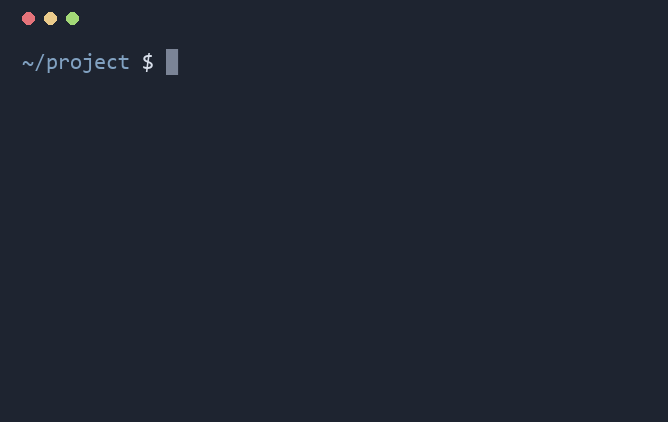

# hanfix

[](https://github.com/NaNIsaac/hanfix/actions/workflows/ci.yml) [](LICENSE)

**Typed a command with the Korean keyboard layout still on? Type `hf` and hanfix re-runs it in QWERTY.**

[한국어](README.ko.md)

```console
$ ㅣㄴ -ㅁ
bash: ㅣㄴ: command not found
$ ㅗㄹ
ls -a  [Enter / Ctrl+C]
.  ..  .git  README.md	src
$ 햣 촏차ㅐㅕㅅ -ㅠ 럍-쇼ㅔㅐ
bash: 햣: command not found
$ ㅗㄹ
git checkout -b fix-typo  [Enter / Ctrl+C]
Switched to a new branch 'fix-typo'
```

`ㅗㄹ` is what `hf` becomes when the Korean layout is still on, so both names work and you never have to
switch layouts to fix the mistake.

Try the conversion on its own. It only prints:

```console
$ hanfix ㅣㄴ -ㅁ
ls -a
$ hanfix dkssudgktpdy
안녕하세요
```

On a Korean keyboard, forgetting to press the 한/영 key turns `ls -a` into `ㅣㄴ -ㅁ`. hanfix maps the
Hangul back to the keys you pressed (2-set / KS X 5002 layout), shows the fixed command, and runs it when
you press Enter. It is a single executable with no runtime, for Linux, macOS and Windows, with bash, zsh,
fish and PowerShell.



## Install

**Linux / macOS**

```sh
curl -fsSL https://github.com/NaNIsaac/hanfix/releases/latest/download/install.sh | sh
```

**Windows (PowerShell)**

```powershell
irm https://github.com/NaNIsaac/hanfix/releases/latest/download/install.ps1 | iex
```

The install script:
1. Downloads the executable for your OS and CPU from [Releases](https://github.com/NaNIsaac/hanfix/releases).
2. Checks its SHA-256 checksum.
3. Puts it in the install folder.
   - Linux/macOS: `~/.local/bin`
   - Windows: `%LOCALAPPDATA%\Programs\hanfix`, which is added to your user PATH.
4. Prints the line to add to your shell configuration.

Set `HANFIX_INSTALL_DIR` to change the install folder, and `HANFIX_VERSION=v0.2.3` to pick a version.

With Rust, you can install from source:

```sh
cargo install --git https://github.com/NaNIsaac/hanfix
```

## Update

```sh
hanfix --update
```

- Re-runs the install script to replace this copy with the latest release, in the folder the running hanfix is in.
- The checksum is checked as on a first install.
- Re-running the install command (`curl … | sh`, `irm … | iex`) does the same.
- If you installed with `cargo install`, use `cargo install --git https://github.com/NaNIsaac/hanfix --force`.
- `hanfix -V` prints the current version.

## Shell setup

`hf` is a shell function, because only the shell knows the previous command. Add one line to your shell's
start-up file and open a new terminal.

| Shell | File | Line |
|---|---|---|
| bash | `~/.bashrc` | `eval "$(hanfix --init bash)"` |
| zsh | `~/.zshrc` | `eval "$(hanfix --init zsh)"` |
| fish | `~/.config/fish/config.fish` | `hanfix --init fish \| source` |
| PowerShell | `$PROFILE` | `Invoke-Expression (hanfix --init powershell \| Out-String)` |

In PowerShell, run this once:

```powershell
Add-Content $PROFILE 'Invoke-Expression (hanfix --init powershell | Out-String)'
```

To see the code that gets defined, run e.g. `hanfix --init bash`.

## Usage

### Fix the previous command

| Command | What it does |
|---|---|
| `hf` or `ㅗㄹ` | Shows the fixed command and runs it on Enter. Ctrl+C cancels. |
| `hf -y` | Runs it without asking. |

**Steps**
1. Takes the previous command from shell history, skipping `hf` itself.
2. Maps Hangul jamo back to English keys. If nothing changes, prints `nothing to fix` and stops.
3. Shows the fixed command in green and waits for Enter.
4. Adds the fixed command to shell history and runs it, so the up arrow brings it back. fish does not get
   the history entry (fish 3 has no command to add one).

`--alias` renames the function. The Korean-layout name is defined too; for example `--alias fk` defines
`fk` and `라`.

```sh
eval "$(hanfix --init bash --alias fk)"
```

### Convert text directly

```
hanfix ㅣㄴ -ㅁ               ->  ls -a
hanfix 햣 ㄴㅅㅁ션             ->  git status
hanfix dkssudgktpdy          ->  안녕하세요
echo ㅊㅇ .. | hanfix         ->  cd ..          (reads stdin too)
hanfix --to ko git           ->  햣             (forced direction)
hanfix --to en 한글           ->  gksrmf
```

**The direction is automatic.** Text with any Hangul goes back to English keys; anything else is composed
into Hangul. If the guess is wrong, use `--to ko` or `--to en`.

### Options

```
usage: hanfix [-h] [-V] [--to {ko,en}] [--] [TEXT ...]
       hanfix --init {bash,zsh,fish,powershell} [--alias NAME]
       hanfix --update
```

| Option | Description |
|---|---|
| `-h`, `--help` | Print help. |
| `-V`, `-v`, `--version` | Print the version. |
| `--update` | Update to the latest release. |
| `--to {ko,en}` | Force the direction. `ko`: English keys to Hangul; `en`: Hangul to English keys. |
| `--init SHELL` | Print the shell code that defines `hf`. |
| `--alias NAME` | Name of the function `--init` defines. Default `hf`. |
| `--` | End of options. Everything after is text. |

- Options are read only at the start; the rest is text to convert. So the `-ㅁ` in `hanfix ㅣㄴ -ㅁ` is
  text (`-a`), not an option.
- To convert English text that starts with `-`, put `--` first: `hanfix -- -rk` → `-가`.
- Exit status: 0 on success, 2 on a usage error.

### Fix the line you are typing (optional)

A key binding that fixes the current line in place before you run it. This setup has not been tested.

**PowerShell** (`Ctrl+Alt+h`)

```powershell
Set-PSReadLineKeyHandler -Chord 'Ctrl+Alt+h' -BriefDescription hanfix -ScriptBlock {
    $line = $null; $cursor = $null
    [Microsoft.PowerShell.PSConsoleReadLine]::GetBufferState([ref]$line, [ref]$cursor)
    $enc = [Console]::OutputEncoding; [Console]::OutputEncoding = [Text.Encoding]::UTF8
    try { $fixed = (hanfix -- $line | Out-String).TrimEnd() } finally { [Console]::OutputEncoding = $enc }
    [Microsoft.PowerShell.PSConsoleReadLine]::RevertLine()
    [Microsoft.PowerShell.PSConsoleReadLine]::Insert($fixed)
}
```

**bash** (`Alt+h`)

```bash
bind -x '"\eh": READLINE_LINE=$(hanfix -- "$READLINE_LINE"); READLINE_POINT=${#READLINE_LINE}'
```

## How it works

**English keys → Hangul** uses the same automaton as a real 2-set (KS X 5002) input method.
- Each key maps to a jamo (`r` → ㄱ, `k` → ㅏ). Shift matters only for the double consonants and ㅒ, ㅖ;
  other capitals are treated as lowercase.
- Compound vowels (ㅘ, ㅢ, ...) and compound finals (ㄳ, ㄺ, ㅄ, ...) are combined.
- A final consonant followed by a vowel moves to the next syllable.
  - `rkrk` → 가가
  - `rkqtdl` → 값이: only the second consonant of a compound final moves.
- ㄸ, ㅃ, ㅉ cannot be finals, so they always start a new syllable.
- Syllables are built with the Unicode formula `0xAC00 + (initial×21 + medial)×28 + final`.

**Hangul → English keys** reverses the formula to get initial, medial and final, splits compound jamo, and
maps each to its key.

Characters that are not on the layout (digits, spaces, symbols) are left as they are.

## Limitations

- **`hf` only converts Hangul to English.** Commands are in English, so only that direction makes sense.
- **One direction per line.** In mixed text like `git ㅔㅕ노`, the Hangul means everything goes to English
  keys, including any Hangul word you meant to keep.
- **2-set only.** 3-set (세벌식) and non-QWERTY English layouts (Dvorak etc.) are not supported.

## Development

```sh
cargo test           # composition cases, round trip of all 11,172 Hangul syllables, shell code
sh tests/shells.sh   # in bash, zsh and fish, hf actually runs the fixed command (uses the installed hanfix)
pwsh tests/shells.ps1
```

- CI runs all of the above on Linux, macOS and Windows.
- Pushing a `v*` tag uploads executables for 6 platforms to Releases: Linux, macOS, Windows × x86_64, arm64.
- Rebuild the demo GIF with `python assets/make_demo.py` (needs Pillow).

## Uninstall

- Linux/macOS: `rm ~/.local/bin/hanfix`
- Windows: `Remove-Item -Recurse "$env:LOCALAPPDATA\Programs\hanfix"`

Also remove the line you added to your shell start-up file.

## License

MIT
